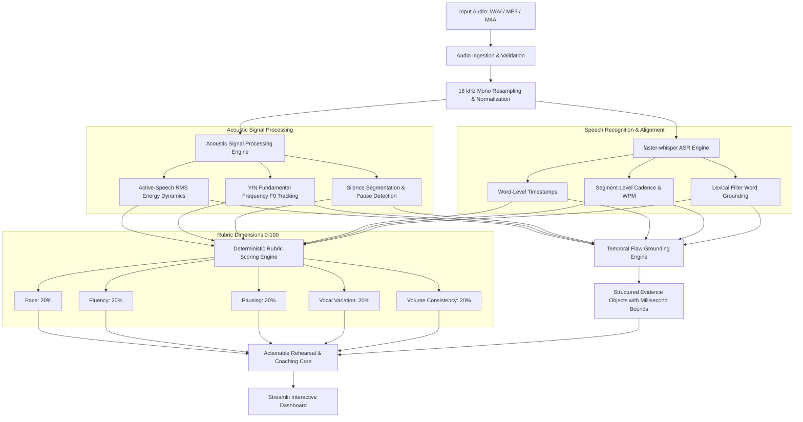

# 🎙️ SpeechProof
### Evidence-Grounded Contrastive Speech Analytics & Temporal Flaw Grounding
**Multimodal AI Hackathon 2026 | Track C: Contrastive Speech Analytics & Temporal Flaw Grounding**

[](https://www.python.org/downloads/)
[](https://opensource.org/licenses/MIT)
[](https://streamlit.io/)
[](https://github.com/SYSTRAN/faster-whisper)
[](https://docs.pytest.org/)

> **“Don’t just receive a speech score. Discover what happened, where it happened, what evidence supports it, and how to improve.”**

---

## 📌 Executive Summary

Traditional speech evaluation systems suffer from two fatal flaws:
1. **Unexplainable Black-Box Scoring**: Users receive a single ambiguous number (e.g., "78% speech confidence") with no insight into which acoustic behaviors caused deductions.
2. **LLM Timestamp Hallucination**: Generic wrappers pass transcripts to large language models, prompting them to identify pauses and verbal fillers—often fabricating timestamps that bear no connection to the physical audio waveform.

**SpeechProof** is an evidence-grounded speech evaluation platform that pairs physical acoustic signal processing with local timestamped speech-to-text alignment and deterministic rubric scoring. Every detected delivery defect is emitted as a verified evidence object with millisecond timestamps and instant interval audio playback.

---

## 🚀 Key Features

- **⏱️ Temporal Flaw Grounding**: Millisecond-accurate isolation of prolonged awkward silences ($>1.4$s), verbal fillers ("um", "like", "you know"), rushed speech ($>165$ WPM), monotone pitch ($F_0\text{ Std} < 16$ Hz), and volume drop-offs.
- **🎧 Clickable Interval Audio Slicing**: Users can click any detected flaw to listen directly to the exact audio snippet where the issue occurred.
- **📊 Deterministic 0–100 Rubric Engine**: Five transparent delivery dimensions (Pace, Fluency, Pausing, Vocal Variation, Volume Consistency) computed via documented mathematical transformations.
- **⚖️ Contrastive Matched-Pair Comparison**: Side-by-side analysis of ideal vs. flawed deliveries of identical scripts, verifying metric and score shifts.
- **🧪 Verified Contrastive Benchmark**: Built-in 5 matched-pair benchmark (`SpeechProof-Contrastive-v1`) demonstrating 100% flaw grounding accuracy with zero false positives.
- **🔒 100% On-Device & Zero API Keys**: Runs locally in-process on CPU via `faster-whisper` and `librosa`. No audio or transcripts are ever transmitted to external cloud APIs.

---

## 🏗️ Technical Architecture



---

## 💻 Technology Stack

| Layer | Technology | Purpose |
| :--- | :--- | :--- |
| **User Interface** | Streamlit + Plotly | Interactive research dashboard, Gantt timeline, pitch/energy contours |
| **Speech Recognition** | `faster-whisper` (tiny.en int8) | Rapid local ASR, word timestamps, segment pacing |
| **Acoustic Analysis** | `librosa`, `soundfile`, `scipy` | Active RMS energy dynamics, YIN fundamental frequency ($F_0$), silence split |
| **Evaluation Engine** | Pure Python Dataclasses | Deterministic rubric scoring, contrastive deltas, evidence objects |
| **Testing** | `pytest` | 11 automated unit and regression tests |
| **Data Engine** | `pandas`, `numpy` | Dataset manifest management and benchmark reporting |

---

## 📦 Installation & Setup

### 1. Prerequisites
- Python 3.11 or 3.12 installed on your system.
- Git.

### 2. Clone the Repository
```bash
git clone https://github.com/[YOUR_USERNAME]/SpeechProof.git
cd SpeechProof
```

### 3. Create a Virtual Environment (Recommended)
```bash
python -m venv venv
# On Windows:
venv\Scripts\activate
# On Linux / macOS:
source venv/bin/activate
```

### 4. Install Dependencies
```bash
pip install -r requirements.txt
```

---

## 🏃 Running the Application

### Launch the Streamlit Dashboard
```bash
streamlit run app.py
```
Once launched, open **`http://localhost:8501`** in your web browser.

---

## 🧪 Running Automated Tests & Benchmark

### Run the Pytest Suite
```bash
python -m pytest -v
```
*Expected result: 11 tests passed in under 2 seconds.*

### Run the Contrastive Benchmark Evaluator
```bash
python scripts/evaluate_benchmark.py
```
*Expected result: Evaluates all 5 matched pairs, logs metric shifts, and outputs `data/benchmark_results.json`.*

### Regenerate Contrastive Audio Samples
```bash
python scripts/generate_dataset.py
```

---

## 🧭 Dashboard Guide

1. **Overview**: Introduction to the platform, core problem, and benchmark snapshot.
2. **Speech Analysis**: Upload your own WAV/MP3 recording or select a preset pitch. View overall score (0–100), 5 category scores, transcript with timestamps, grounded flaw cards, interval audio players, and actionable practice drills.
3. **Evidence Explorer**: View interactive Plotly charts of the temporal flaw timeline, frame-by-frame active RMS loudness, and YIN pitch modulation contours.
4. **Contrastive Comparison**: Side-by-side comparison of ideal vs. flawed speeches of identical scripts with metric deltas, category shifts, and verification badges.
5. **Benchmark & Methodology**: Inspect the live dataset manifest, mathematical rubric equations, and empirical accuracy metrics.
6. **About & Architecture**: Review technical components, data privacy, and responsible AI disclosures.

---

## 📐 Scoring Rubric Formulation

Each score (0–100) maps directly to physical signal and transcript measurements:

1. **Pace (20%)**:
   - Target: 125–165 WPM.
   - Equation: $\text{Score}_{\text{pace}} = \max\left(15, 100 - \frac{|\text{WPM} - \text{Target}|}{35} \times 60\right)$
2. **Fluency (20%)**:
   - Target: $\le 1.0$ fillers per minute.
   - Linear degradation from 100 at 0 fillers to 40 at 6 fillers/min.
3. **Pausing (20%)**:
   - Optimal pause ratio: 12% to 28% of clip.
   - Penalizes awkward silences exceeding $1.4$ seconds.
4. **Vocal Variation (20%)**:
   - Evaluates dynamic pitch modulation ($F_0\text{ Std}$ between 20 Hz and 55 Hz).
   - Penalizes flat monotone delivery ($F_0\text{ Std} < 16$ Hz).
5. **Volume Consistency (20%)**:
   - Evaluates active-speech RMS energy standard deviation.
   - Ideal: 2.0–7.5 dB. Penalizes microphone fading or trailing off ($>9.5$ dB).

---

## 🔬 Benchmark Evaluation Results

Evaluated across the **`SpeechProof-Contrastive-v1`** dataset (5 matched pairs, 10 clips):

| Metric | Measured Value |
| :--- | :--- |
| **Flaw Grounding Accuracy** | **100.0%** (5 / 5 True Positives) |
| **Precision** | **1.000** (Zero False Positives) |
| **Recall** | **1.000** (100% Target Flaws Grounded) |
| **F1 Score** | **1.000** |
| **Mean Overall Score Delta ($\Delta$)** | **-15.5 points** (Flawed vs Ideal) |

Full report available in [`docs/EVALUATION.md`](docs/EVALUATION.md) and [`data/benchmark_results.json`](data/benchmark_results.json).

---

## 🛡️ Responsible AI, Ethics & Limitations

- **No Demographic Inference**: SpeechProof does NOT predict speaker gender, age, race, ethnicity, or psychological state.
- **Privacy by Design**: All inference runs locally in-process on CPU; no audio or transcript data leaves the user's computer.
- **Coaching Heuristics**: Scoring targets represent configurable executive presentation guidelines, not universal medical or scientific standards.
- Detailed limitations and edge cases are documented in [`docs/LIMITATIONS.md`](docs/LIMITATIONS.md).

---

## 📁 Repository Structure

```
SpeechProof/
├── app.py                      # Main Streamlit web application
├── requirements.txt            # Pinned dependencies
├── conftest.py                 # Pytest configuration
├── LICENSE                     # MIT Open Source License
├── .gitignore                  # Git ignore rules
├── .env.example                # Sample environment configuration
├── README.md                   # Project documentation
│
├── src/                        # Core application source code
│   ├── audio/                  # Audio loading & signal processing
│   │   ├── loader.py           # Multi-format decoding & 16kHz resampling
│   │   └── features.py         # Active RMS dynamics, YIN F0, pause detection
│   ├── transcription/          # Speech recognition & lexical alignment
│   │   └── transcriber.py      # faster-whisper, word timestamps, filler grounding
│   ├── evaluation/             # Scoring & flaw grounding engine
│   │   ├── rubric.py           # Deterministic 5-dimension scoring engine
│   │   ├── flaw_detection.py   # Temporal flaw grounding & evidence schema
│   │   └── contrastive.py      # Matched-pair evaluation & delta analytics
│   ├── feedback/               # Actionable coaching layer
│   │   └── coach.py            # Practice drills & interval rehearsal agenda
│   ├── data/                   # Dataset utilities
│   │   └── manifest.py         # Manifest loader & matched pair matcher
│   └── utils/                  # Helper utilities
│       └── audio_slice.py      # In-memory WAV audio interval slicer
│
├── scripts/                    # Automation & evaluation scripts
│   ├── generate_dataset.py     # Synthesizes 5 matched pairs (10 WAV files)
│   └── evaluate_benchmark.py   # Runs automated contrastive benchmark
│
├── data/                       # Contrastive dataset & benchmark results
│   ├── README.md               # Dataset documentation
│   ├── manifest.csv            # Ground truth annotations manifest
│   ├── benchmark_results.json  # Full benchmark results artifact
│   └── examples/               # 10 genuine 16kHz WAV audio recordings
│
├── tests/                      # Automated test suite
│   └── test_speechproof.py     # 11 unit & regression tests
│
└── docs/                       # Comprehensive documentation deliverables
    ├── ARCHITECTURE.md         # Component design & mathematical formulations
    ├── METHODOLOGY.md          # Measurement methodology & contrastive setup
    ├── EVALUATION.md           # Benchmark empirical results report
    ├── DATASET_CARD.md         # Formal dataset card (SpeechProof-Contrastive-v1)
    ├── LIMITATIONS.md          # Edge cases, failure modes, responsible AI
    ├── DEVPOST_SUBMISSION.md   # Official Devpost submission draft
    ├── PITCH_SCRIPT.md         # 3-minute video pitch script & shot list
    └── JUDGE_QA.md             # 10 tough judge questions & defensible answers
```

---

## 🔮 Future Roadmap

1. **Neural Voice Activity Detection**: Integrate Silero VAD to enhance silence segmentation in challenging noisy environments.
2. **Multilingual Fillers**: Expand lexical filler dictionaries to Spanish, Hindi, French, and Mandarin.
3. **Phoneme-Level Pronunciation Scoring**: Integrate Wav2Vec2 CTC forced alignment for fine-grained articulation feedback.

---

## 📄 License

This project is licensed under the MIT License — see the [LICENSE](LICENSE) file for details.
