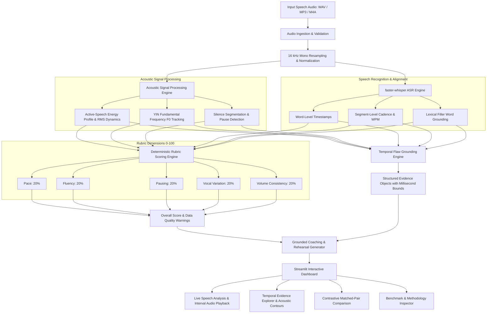

# SpeechProof: Technical Architecture

## 1. System Overview

SpeechProof is an evidence-grounded speech analytics and temporal flaw grounding platform developed for Track C of the Multimodal AI Hackathon 2026. The platform replaces subjective, single-number coaching impressions and hallucinated LLM feedback with deterministic signal processing, timestamped speech recognition, reproducible rubric scoring, and contrastive evaluation.



---

## 2. Component Specifications

### 2.1 Audio Ingestion & Preprocessing (`src/audio/loader.py`)
- **Format Support**: Multi-format audio decoding via `soundfile` and `librosa`.
- **Target Normalization**: Dual-channel downmixing to single-channel mono; resampled to a standardized 16,000 Hz float32 array.
- **Safety Bounds**: Max file size constraint (50MB) and max audio duration (600s) to prevent memory exhaustion.
- **Signal Normalization**: Non-clipping peak scaling preserving dynamic range with zero phase distortion.

### 2.2 Acoustic Signal Analysis (`src/audio/features.py`)
- **Loudness Dynamics**:
  - RMS energy computed frame-by-frame (frame length: 50ms, hop: 25ms).
  - Energy computed across **active speech frames** (frames within 35 dB of peak), isolating actual spoken vocal power from background room noise or dead silence.
  - Metrics: Active RMS Mean (dB), Active RMS Standard Deviation (dB), and 95th-to-5th percentile Dynamic Range (dB).
- **Pitch Modulation (Fundamental Frequency $F_0$)**:
  - Extracted using the robust YIN algorithm (`librosa.yin`) bounded between 65 Hz and 350 Hz.
  - Voiced audio ratio gating (requires $\ge 20\%$ voiced frames for confident pitch assessment).
  - Metrics: Mean $F_0$ (Hz), $F_0$ Standard Deviation (Hz), and Pitch Range (Hz).
  - Monotone heuristic: Pitch standard deviation $< 16.0$ Hz indicates flat, monotonous inflection.
- **Pausing & Silence Segmentation**:
  - Energy thresholding via `librosa.effects.split` (top_db: 28 dB relative to signal peak).
  - Detects non-silent vocal bursts; gaps $\ge 0.35$s are classified as pauses.
  - Awkward silences exceeding configurable threshold ($\ge 1.4$s) trigger grounded prolonged pause defects.

### 2.3 Speech Recognition & Lexical Alignment (`src/transcription/transcriber.py`)
- **Model**: Local pretrained `faster-whisper` (`tiny.en` default, int8 quantized execution on CPU).
- **Inference Mode**: Local in-process inference without remote API calls, latency $\approx 1.5$s for a 15-second audio clip.
- **Timestamped Alignment**: Word-level timestamps (`word_timestamps=True`) with segment confidence log-probabilities.
- **Speaking Rate**:
  $$\text{WPM} = \frac{\text{Word Count}}{\text{Duration (seconds)}} \times 60$$
- **Filler Word Detection**: Configurable lexical dictionary (`um`, `uh`, `like`, `you know`, `actually`, `basically`, `literally`, `sort of`, `kind of`).
- Emits timestamped `FillerWordOccurrence` evidence with word boundaries.

### 2.4 Deterministic Rubric Engine (`src/evaluation/rubric.py`)
Computes five orthogonal 0–100 scores using transparent, documented piece-wise mathematical mappings:

1. **Pace Score (20% Weight)**:
   - Target Range: 125–165 WPM.
   - Penalizes rushed cadence ($>165$ WPM) and sluggish cadence ($<125$ WPM).
2. **Fluency Score (20% Weight)**:
   - Target Range: $\le 1.0$ fillers per minute (Score = 100).
   - Degrades linearly to 40 at 6 fillers/min, dropping below 40 for excessive filler density.
3. **Pausing Score (20% Weight)**:
   - Normal pause ratio band: 12% to 28% of total presentation time.
   - Combines pause ratio scoring with heavy penalties for prolonged awkward silences ($>1.4$s).
4. **Vocal Variation Score (20% Weight)**:
   - Evaluates dynamic pitch inflection ($F_0$ Std between 20 Hz and 55 Hz).
   - Penalizes flat monotone delivery ($F_0$ Std $<16$ Hz) and erratic voice cracks.
5. **Volume Consistency Score (20% Weight)**:
   - Evaluates active-speech RMS energy standard deviation.
   - Ideal: 2.0–7.5 dB. Penalizes microphone fading, trailing off, or abrupt volume drops ($>9.5$ dB).

### 2.5 Temporal Flaw Grounding Schema (`src/evaluation/flaw_detection.py`)
Every detected defect is emitted as a structured, validated evidence object:

```json
{
  "flaw_type": "prolonged_pause",
  "start_time": 5.9,
  "end_time": 9.2,
  "duration": 3.3,
  "severity": "severe",
  "metric_name": "pause_duration",
  "observed_value": 3.3,
  "unit": "seconds",
  "threshold": 1.4,
  "rubric_category": "Pausing",
  "explanation": "Awkward silence of 3.30s exceeds the natural delivery threshold of 1.4s.",
  "recommendation": "Replace extended dead silences with deliberate transitions, bridging remarks, or forward-looking connective phrases.",
  "evidence_source": "audio_signal",
  "confidence": 0.98,
  "context_text": "Our infrastructure team recently migrated forty backend microservices to an event-driven architecture."
}
```

### 2.6 Audio Slicing Utility (`src/utils/audio_slice.py`)
Generates in-memory WAV slices corresponding to `[start_time - 0.2s, end_time + 0.2s]`, enabling users to click any finding in the dashboard and immediately listen to the exact audio snippet where the defect occurred.
